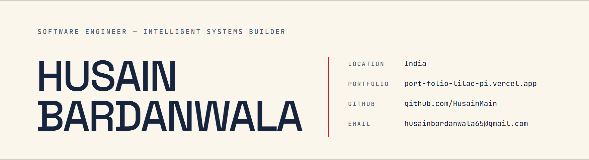

  <picture>
    <source media="(prefers-color-scheme: dark)" srcset="assets/banner-dark.png">
    
  </picture>

`STATUS` Open to a summer 2027 internship  ·  `DEGREE` B.E. Computer Engineering  ·  `CGPA` 8.48 / 10  ·  `BASED` India

I build software systems end to end — AI as an accelerator, engineering judgment as the final filter. Currently in my third year at SVIT Vasad, shipping full-stack products and data work between semesters.

## `01` — Seven builds, documented.

### [IdeaBridge](https://github.com/HusainMain/ideabridge) — AI startup validation

A four-step founder intake feeds an Express API that returns SWOT, competitor analysis and a readiness score. Responses are cached and rate-limited; failures come back as mapped error codes rather than raw exceptions.

`React 18` `TypeScript` `Express` `Groq` `Three.js` · [live](https://ideabridge-six.vercel.app)

### [iEMS](https://github.com/HusainMain/iEMS) — role-based education platform

Built in 24 hours at the CVMU state-level hackathon. Admin, teacher and student surfaces share one Firestore dataset, and access is enforced in security rules with a default-deny catch-all — not hidden in the client.

`React 19` `Firebase` `Tailwind CSS`

### [IPL match analysis](https://github.com/HusainMain/IPL_Analysis) — 1,095 matches, 260,920 deliveries

Every IPL match from 2008 to 2024: 19 team names reconciled to 15 franchises, 1,160 missing values filled column by column. A validation pass caught a win-tally chart that had been silently dropping all 14 tied matches.

`Python` `pandas` `NumPy` `Matplotlib` `Seaborn`

### [BuildEx](https://github.com/HusainMain/buildex-website) — official club website

Site for SVIT's startup and entrepreneurship club. Canvas-drawn hexagonal hero, pinned-scroll storytelling, events and gallery fed from data modules. Every animated section honours `prefers-reduced-motion` and resolves to its end state.

`React 19` `TypeScript` `GSAP` `Tailwind CSS` `Vite` · [live](https://buildex-website-sooty.vercel.app)

### [SmartStudyPlanner](https://github.com/HusainMain/SmartStudyPlanner) — study planner with accounts

An Express and MongoDB API behind a vanilla JavaScript client: JWT sessions, bcrypt-hashed passwords, and separate models for users, tasks and subjects.

`Node.js` `Express` `MongoDB Atlas` `Mongoose` `JWT` · [live](https://smart-study-planner-pi-gules.vercel.app)

### [Campus placement analysis](https://github.com/HusainMain/college-placement-analysis) — 215 MBA records

Placement sat at 86.5% with work experience against 59.6% without — until a column check showed every one of the 148 salary offers is a round thousand. The dataset is synthetic, and the notebook opens by saying so.

`Python` `pandas` `Matplotlib` `Seaborn`

### [Healthcare appointment system](https://github.com/HusainMain/Healthcare_Appointment_System) — Java, no dependencies

Six classes modelling appointment queues across seven doctors: a `Person` → `Doctor` / `Patient` hierarchy, an `Appointment`, and a `QueueManager` wrapping a `LinkedList` per doctor. In-memory by design.

`Java` `OOP` `Queue / LinkedList` `Exception handling`

## `02` — What I build with.

**LANGUAGES** `C` `Java` `Python` `JavaScript` `TypeScript` `SQL`

**FRONTEND** `React` `Tailwind CSS` `GSAP` `Vite`

**BACKEND** `Node.js` `Express` `Flask` `MongoDB` `Firebase` `Supabase`

**DATA** `pandas` `NumPy` `Matplotlib` `Seaborn`

**CLOUD & TOOLING** `AWS` `Vercel` `Render` `Git` `GitHub`

## `03` — The record.

**AWS Academy Cloud Foundations** — Training Badge, AWS Training and Certification · 82%

**Finalist, CVMU Hackathon 4.0** — state-level, 24 hours, led a four-person team from problem statement to a working demo

**LeetCode** — arrays, strings, two pointers, trees, hash tables, dynamic programming

---

[LinkedIn](https://www.linkedin.com/in/husain-bardanwala) · [GitHub](https://github.com/HusainMain) · [Portfolio](https://port-folio-lilac-pi.vercel.app) · [LeetCode](https://leetcode.com/u/W9RFMcxTXL/) · [husainbardanwala65@gmail.com](mailto:husainbardanwala65@gmail.com)
